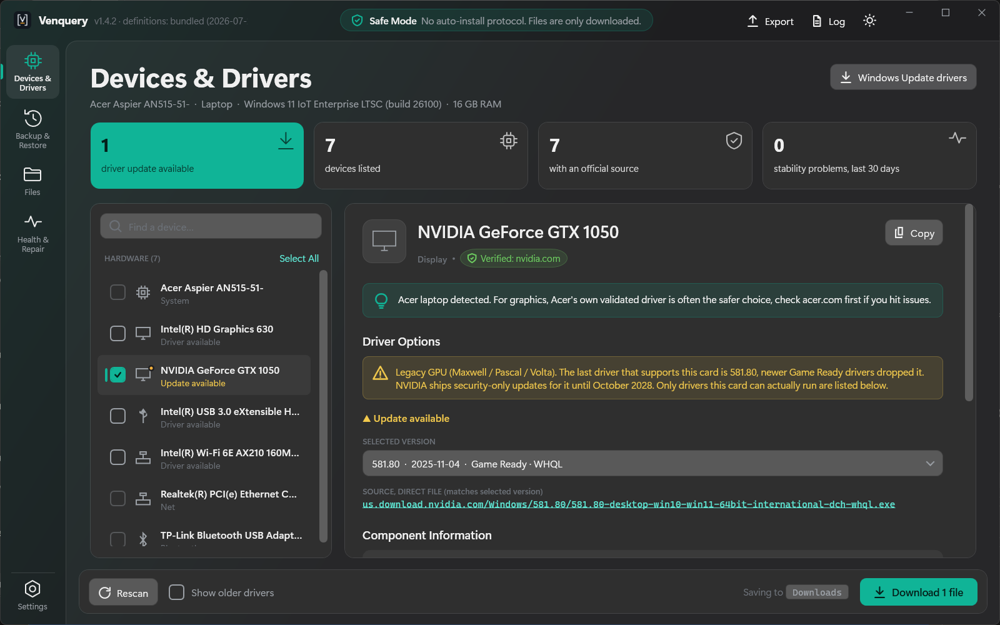
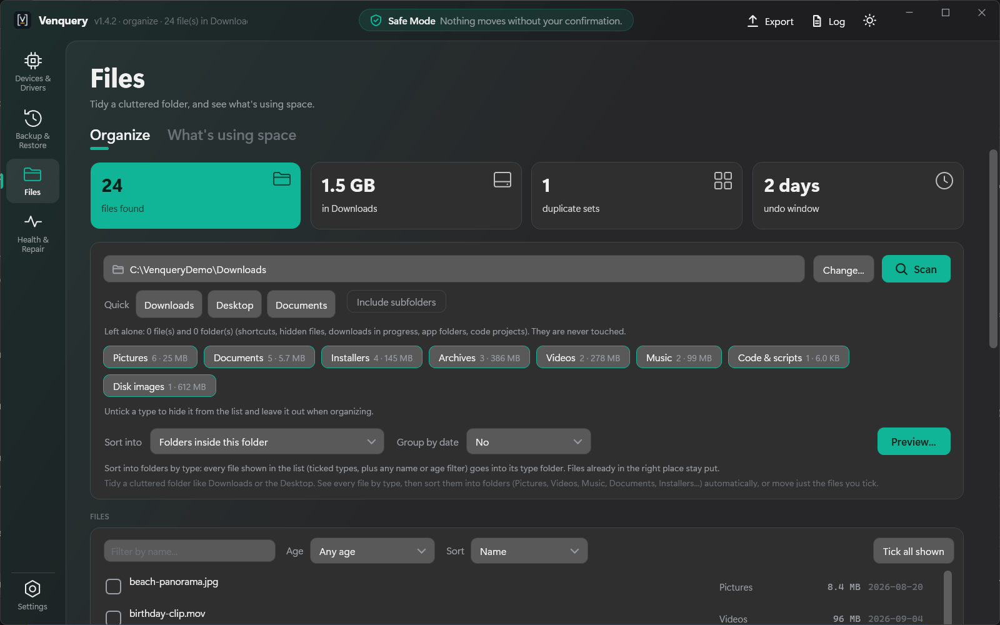
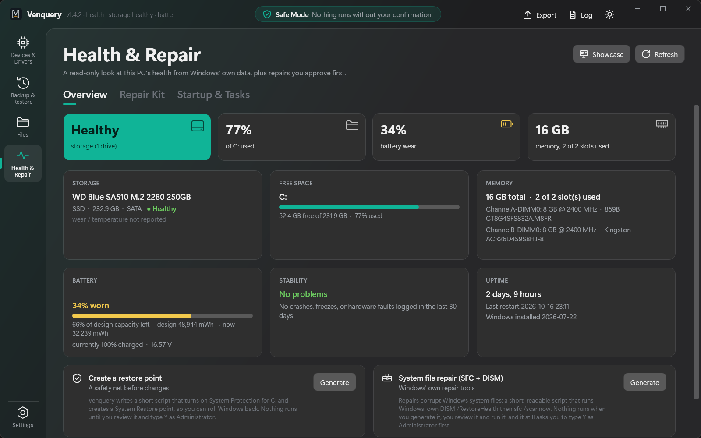
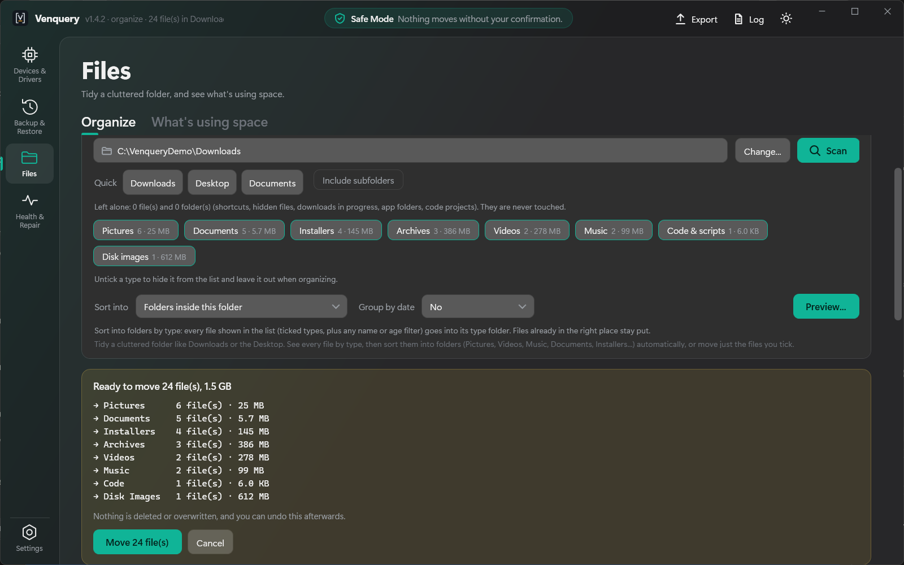
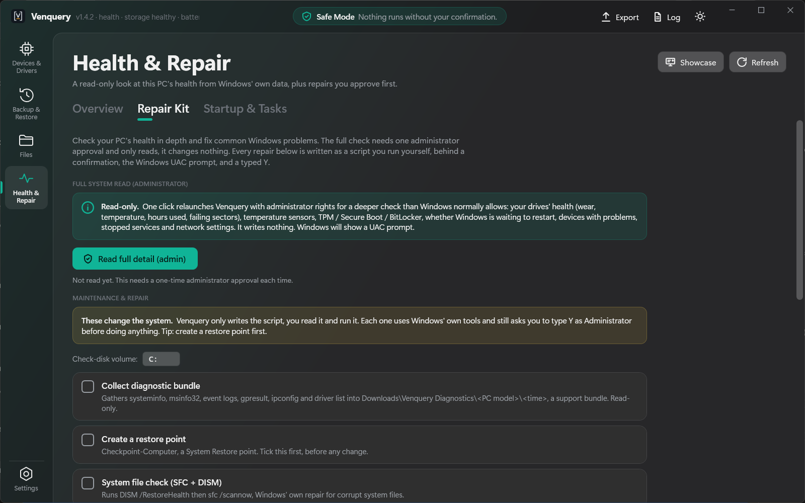
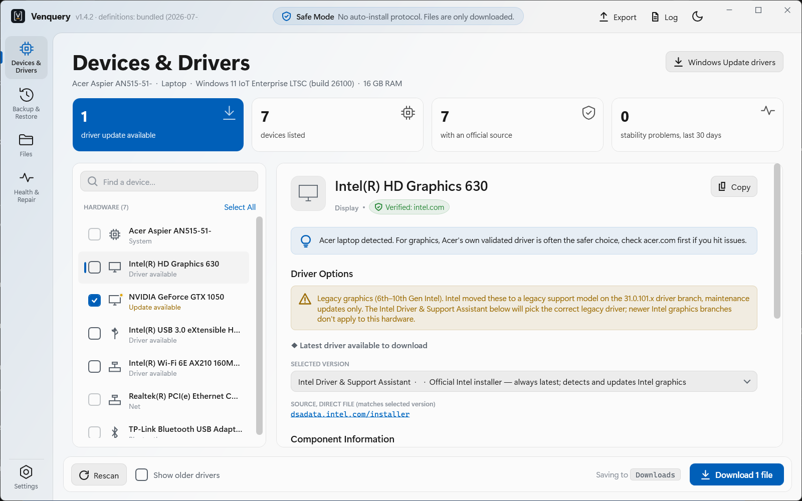
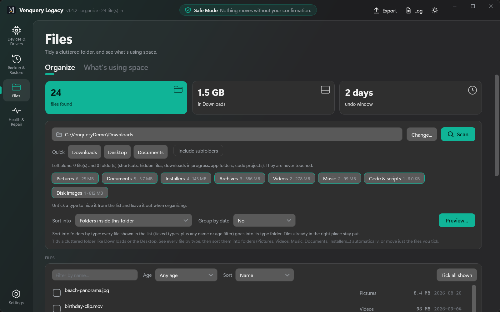
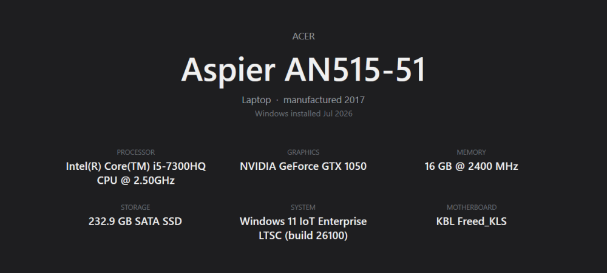

<p align="center">
  
</p>

<h1 align="center">Venquery</h1>

<p align="center">
  <b>Drivers, backups, files and PC health for Windows, in one calm little app.</b><br>
  Built only on Windows' own tools. Nothing installs, runs or moves without you saying so.
</p>

<p align="center">
  <a href="../../releases/latest">Download</a> ·
  <a href="docs/how-it-works.md">How it works</a> ·
  <a href="SECURITY.md">Security</a> ·
  <a href="CHANGELOG.md">Changelog</a>
</p>



## What is it?

Venquery started as a way to find the *right* driver for a PC without third-party "driver updater" junk.
It grew into a small toolkit for the jobs you actually do around a Windows PC: check your drivers, back up
your apps and files before a reset, tidy a messy Downloads folder, and keep an eye on the machine's health.

Two promises shape everything it does:

- **Windows' own tools only.** WMI, winget, pnputil, DISM, SFC, Task Scheduler, Windows Update and the file
  system. No bundled utilities, no kernel drivers, no background service, no telemetry.
- **Safe Mode, always.** Venquery reads and writes files. Anything that changes your PC (a repair, a restore,
  a startup switch, moving files) is shown first, waits for your confirmation, and is reversible wherever
  Windows allows it.

## Features

### Devices & Drivers
- Scans your hardware and matches each device to its manufacturer's **official** driver source: about 140
  brands of graphics, network, storage, audio, input, controllers, capture, docks, printers and scanners.
- Parts made by a chip company that doesn't publish drivers (a laptop's webcam or audio codec) point to your
  PC maker's support page instead. Generic chip IDs shared by countless products are never claimed, so a device
  is never shown under the wrong brand.
- A graphics card built by a board partner (ASUS, MSI, GIGABYTE, Sapphire...) also lists that maker's own
  tuning tool as optional software; the driver still comes from NVIDIA or AMD.
- Shows the newest driver it can verify, and warns when a GPU is on a legacy driver branch (so you don't
  grab a driver your card can't run).
- Downloads come straight from the vendor over HTTPS, then get a SHA-256 hash and an Authenticode signature
  check. Venquery never runs the installer; you do.
- Checks Windows Update for optional driver updates too, and exports a full system report (TXT, CSV, JSON).

### Backup & Restore
- **Installed apps:** saves your app list (via Microsoft's winget) plus a readable restore script. On the new
  install it skips apps that are already there, only runs on the same PC model, and waits for a typed `Y`.
- **Portable apps** and **Documents:** pick drives or folders, see what's there (names and sizes only, never
  contents), and copy what matters. Every backup can write a receipt that checks each copied file.
- **Restore:** finds your Venquery backups and copies them back into dated folders. Nothing is overwritten.
- **Back up everything...:** one wizard that does all of the above, plus an offline driver backup whose
  restore script refuses to run on a different machine.

### Files
- **Organize:** tidy a folder like Downloads into Pictures, Videos, Documents, Installers and friends. You
  always get a preview first. Files are moved, never deleted or overwritten, and every run can be undone
  (or kept for good with "Keep changes").
- Your own rules (`.psd` goes to `Design\Photoshop`), duplicate finder (byte-for-byte, SHA-256), and "move
  the files I ticked".
- **What's using space:** a read-only look at which folders and files take up room.



### Health & Repair
- **Overview:** drive health, free space, memory, battery wear, stability (crashes, freezes and hardware
  errors from the event log) and uptime, all from Windows' own data.
- **Repair Kit:** one optional administrator read for the deep stuff (SMART, temperatures, TPM / Secure Boot /
  BitLocker, pending restarts, problem devices). Plus a library of repairs that Venquery writes as short,
  readable scripts you run yourself: SFC + DISM, component cleanup, CHKDSK, Windows Update reset, network
  reset, DNS flush, restore point, Disk Cleanup, power reports and a diagnostic bundle.
- **Startup & Tasks:** see what starts with Windows and switch programs or scheduled tasks on and off
  (the same switch Task Manager uses). Nothing is ever deleted.
- **Showcase:** a clean, full-screen spec card of your PC, ready for a screenshot.



### And the rest
- Six themes (dark and light), your own background image, and a left-handed layout.
- A command line for scripts and servers: `Venquery.exe --health`, `--report [--json]`, `--version`, `--help`.

## Download

Grab the latest from **[Releases](../../releases/latest)**:

| Package | For | Notes |
|---|---|---|
| `Venquery-<version>-win-x64.zip` | Windows 10 and 11 (64-bit) | One self-contained `Venquery.exe`. No .NET install needed. |
| `Venquery-Legacy-<version>.zip` | Windows 7 and 8.1 | Needs .NET Framework 4.8 (built into 8.1; a free Microsoft download for 7). |

Unzip anywhere and run. There's no installer, and nothing is added to Windows. Settings, session logs and
organize undo history live in `%LOCALAPPDATA%\Venquery-Community` (or `Venquery-Legacy`), plus a `Themes`
folder next to the exe if you add a background image. Delete those and Venquery is gone. Each release lists
SHA-256 checksums so you can verify your download.

> **Windows SmartScreen** may warn the first time because the exe isn't code-signed yet. Click
> *More info → Run anyway*, or check the checksum first if you'd like to be sure.

### What Legacy includes
Venquery Legacy runs the core of the app on Windows 7 and 8.1: Devices & Drivers, Portable apps, Documents,
Files (Organize and What's using space), Health with the restore point and SFC scripts, and Settings. Things that
need newer Windows aren't there: winget app backups, the reset wizard, the Restore tab and the Repair Kit.
Startup items are shown read-only.

## A closer look

| | |
|---|---|
|  |  |
| Every organize run shows exactly what will move first. | Repairs are scripts you can read before running. |
|  |  |
| Light and dark themes. | Venquery Legacy on the same features. |



## Privacy

Venquery doesn't collect anything. There's no account, no analytics and no "phone home". The only network
requests it makes are to fetch a driver page or file **you** asked for, from the vendor's own site, plus a
fixed lookup to NVIDIA's public driver service for GeForce cards. File scans read names and sizes, never
contents. The details are in [docs/how-it-works.md](docs/how-it-works.md).

## Building from source

You'll need the [.NET 8 SDK](https://dotnet.microsoft.com/download) on Windows.

```powershell
# run it
dotnet run --project Venquery

# build both packages into dist\ (self-contained Venquery + Legacy), zipped with checksums
powershell -ExecutionPolicy Bypass -File scripts\build.ps1

# unit tests, a fresh build, then automated feature checks on both builds
powershell -ExecutionPolicy Bypass -File scripts\test.ps1
```

The repo layout:

```
Venquery/         the app (WPF, .NET 8)
legacy/           the Windows 7 / 8.1 build (.NET Framework 4.8), compiling the same source files
Venquery.Tests/   unit tests (xUnit), including safety tripwires for network and process launches
scripts/          build, test and feature-check scripts
docs/             how it works, screenshots
```

## Contributing

Bug reports, driver-source suggestions and pull requests are all welcome. Have a quick read of
[CONTRIBUTING.md](CONTRIBUTING.md) first; it explains the two house rules (Windows' own tools only, and
nothing changes without the user's say-so).

Found a security problem? Please follow [SECURITY.md](SECURITY.md) instead of opening a public issue.

## License

[MIT](LICENSE). Use it, change it, share it.
